# Mermaid Diagrams for Presentation

Copy these diagrams into your slides or use a Mermaid renderer (mermaid.live, VS Code extension, etc.)

---

## 1. System Architecture Diagram

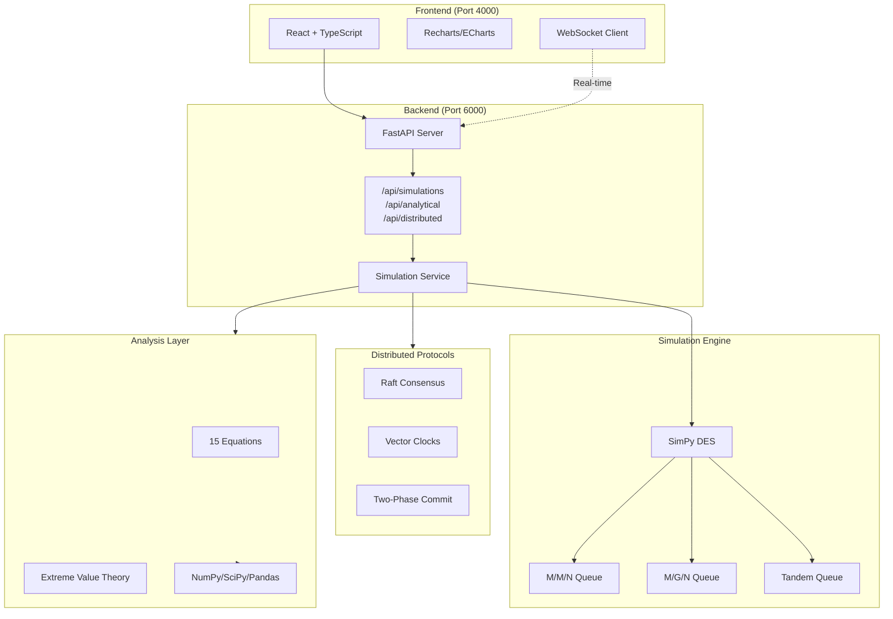

---

## 2. Tandem Queue Network Diagram

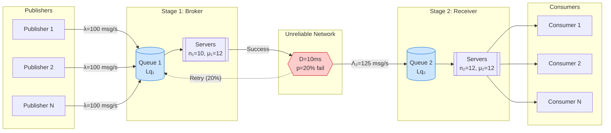

---

## 3. Traffic Inflation Flow

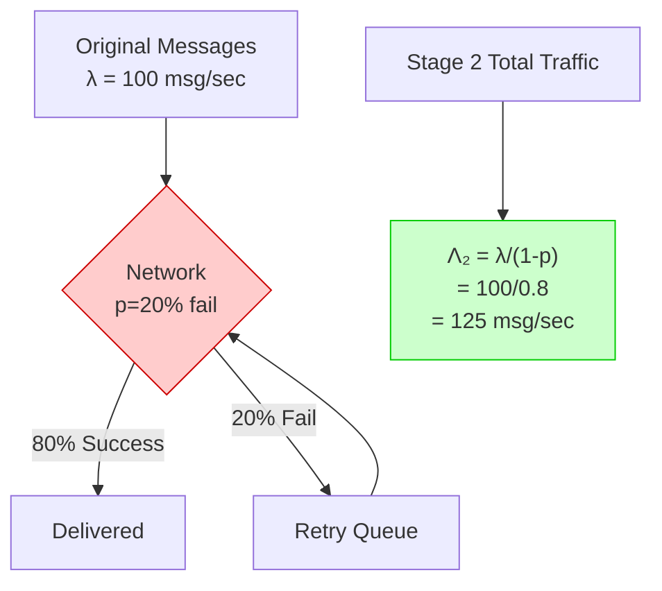

---

## 4. Two-Phase Commit Sequence Diagram

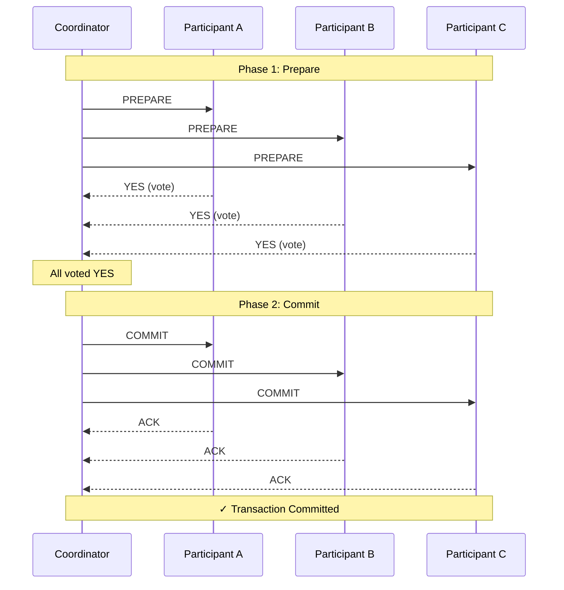

---

## 5. Two-Phase Commit (Abort Scenario)

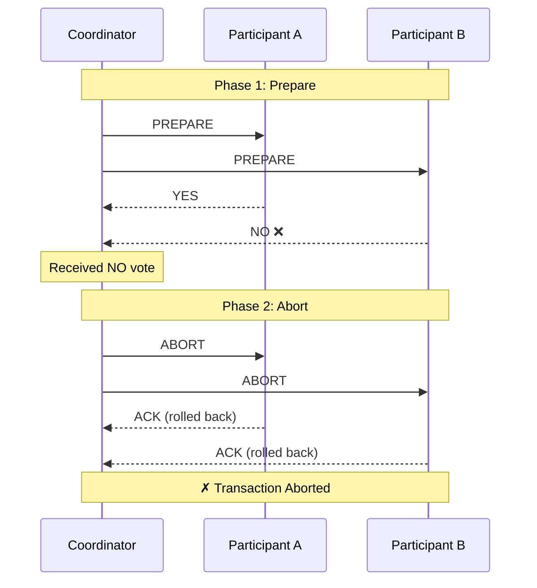

---

## 6. Raft Leader Election Sequence

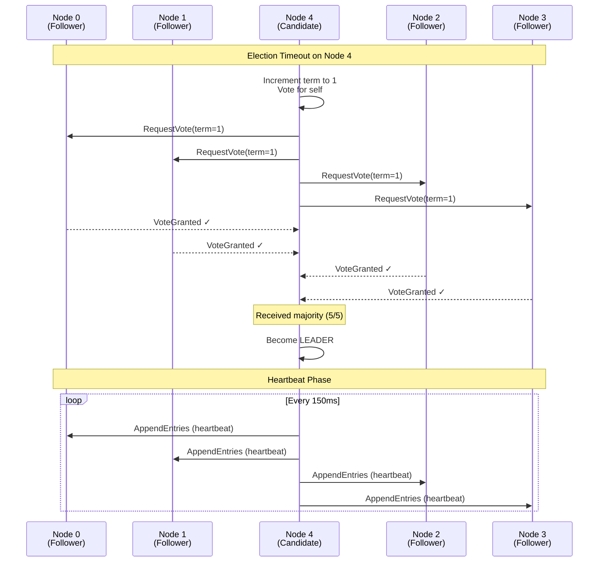

---

## 7. Raft Cluster State Diagram

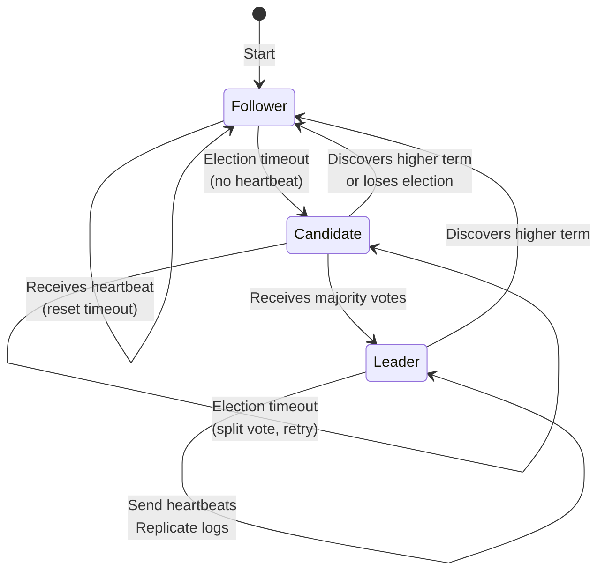

---

## 8. Vector Clocks Timeline

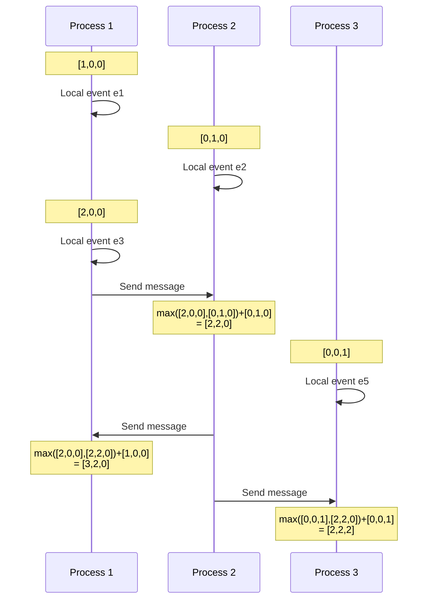

---

## 9. Message Queue Processing Flow

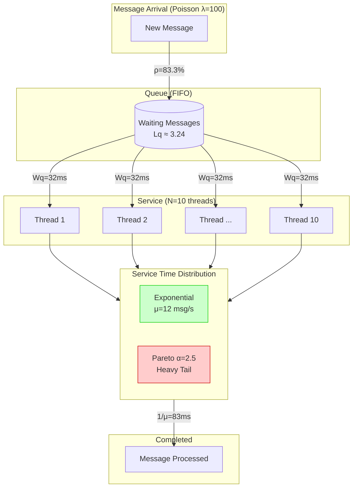

---

## 10. Heavy Tail Impact Comparison

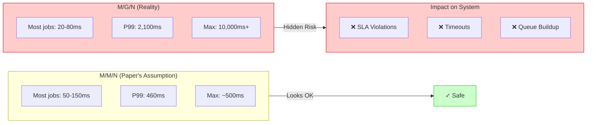

---

## 11. Simulation vs Analytical Pipeline

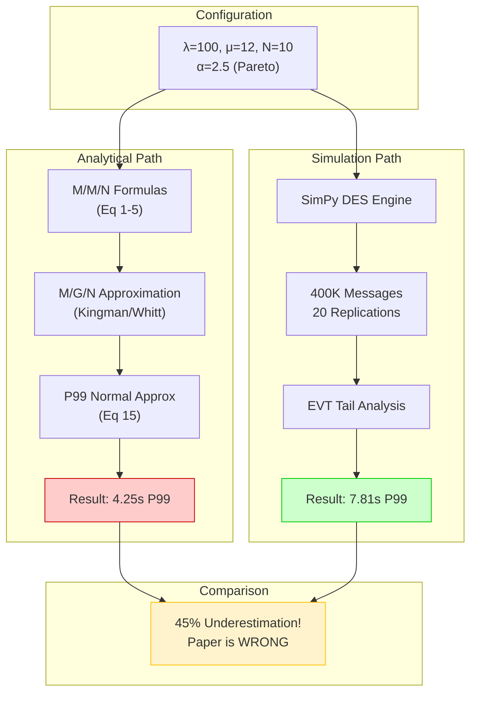

---

## 12. Mitigation Strategy Flow

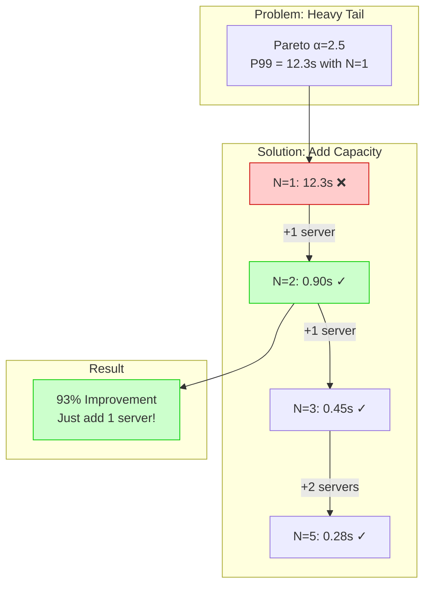

---

## 13. Full System Data Flow

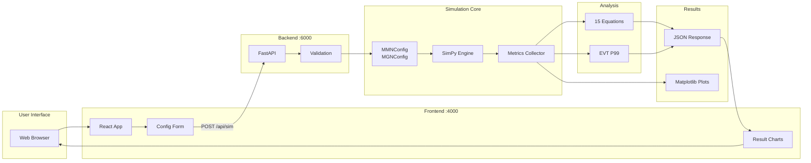

---

## Usage Instructions

### Option 1: Mermaid Live Editor
1. Go to https://mermaid.live
2. Paste the diagram code
3. Export as PNG/SVG

### Option 2: VS Code
1. Install "Mermaid Preview" extension
2. Create `.md` file with diagram
3. Preview and screenshot

### Option 3: PowerPoint/Google Slides
1. Render diagram to image
2. Insert image into slide
3. Add annotations as needed

### Option 4: GitHub/GitLab
- Mermaid renders automatically in markdown files

---

**End of Diagrams**
